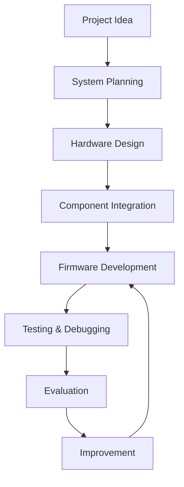

# 🎮 Mini-Console

<p align="center">
  <strong>A Compact Console Project Built from Curiosity, Creativity, and Engineering.</strong>
</p>

<p align="center">
  An experimental mini-console project focused on embedded systems, hardware development, software design, and interactive technology.
</p>

---

## 📖 Overview

**Mini-Console** is a personal engineering project focused on developing a compact console by combining hardware, embedded software, and interactive functionality into a single system.

The project explores how a small electronic device can be designed, programmed, and developed into an interactive platform. It serves as a practical learning environment for understanding the relationship between hardware and software, from system design and component integration to firmware development and user interaction.

Rather than focusing solely on the final product, Mini-Console is also about the engineering process behind it — experimenting with ideas, solving technical problems, learning from failures, and gradually building a functional system.

---

## 🎯 Project Objectives

- Develop a compact and interactive electronic console.
- Explore embedded systems and microcontroller programming.
- Understand hardware and software integration.
- Design a simple and intuitive user interface.
- Experiment with input systems and display output.
- Improve modularity and maintainability of firmware.
- Create a foundation for future features and hardware improvements.

---

## ✨ Features

The project is being developed progressively. The following areas represent the project's development focus.

| Feature | Description | Status |
|---|---|---|
| Console Interface | Interactive interface for navigating the system | 🚧 In Development |
| Input System | Physical controls for user interaction | 🚧 In Development |
| Display System | Visual output and interface rendering | 🚧 In Development |
| Interactive Functions | Console functionality and system interactions | 🚧 In Development |
| Firmware | Embedded software responsible for system behavior | 🚧 In Development |
| Hardware Integration | Integration of electronic components into one platform | 🚧 In Development |
| Expansion | Possibility of adding new features in the future | 📋 Planned |

---

## 🧩 System Overview

Mini-Console is approached as a combination of several fundamental subsystems.

### 1. Hardware

The hardware acts as the physical foundation of the console. It consists of the electronic components responsible for processing, displaying information, receiving user input, and powering the system.

### 2. Firmware

Firmware controls the behavior of the console and connects the hardware components with the software logic.

Its responsibilities include:

- System initialization.
- Input processing.
- Display management.
- Main program execution.
- Feature and function management.
- Hardware communication.

### 3. User Interface

The user interface provides a way to interact with the console. It is designed to make system navigation and operation simple, understandable, and responsive.

### 4. Interactive System

The interactive system is the part of the console responsible for providing functionality and user experiences through software and hardware interaction.

---

## 🛠️ Hardware & Software

> Hardware and software specifications will be documented as the design and implementation are finalized.

### Hardware

| Component | Description |
|---|---|
| Microcontroller | Main processing unit |
| Display | Visual interface and output |
| Input Controls | Physical user interaction |
| Power System | Supplies power to the console |
| Supporting Components | Additional electronic components required by the system |

### Software

| Technology | Purpose |
|---|---|
| Embedded Firmware | Controls the console's hardware and functionality |
| Programming Environment | Used for firmware development and compilation |
| Libraries | Provides support for hardware peripherals and software features |

---

## 🏗️ Development Approach

Mini-Console is developed through an iterative engineering workflow.



Each development stage is intended to improve the system's functionality, stability, and overall design.

---

## 📂 Project Structure

The repository is organized around the project's hardware and software development files.

```text
Mini-Console/
│
├── Mini console/
│   └── Project files
│
├── README.md
└── (Additional files as development progresses)
```

The directory structure may change as the project evolves and additional modules, documentation, and hardware resources are added.

---

## 🚀 Getting Started

Mini-Console is currently under development. Setup and usage instructions will be added when the hardware and firmware workflow is finalized.

### Requirements

The development environment may require:

- A compatible development computer.
- The target microcontroller and hardware components.
- USB connection for programming and debugging.
- The required firmware development environment.
- Supporting libraries and tools used by the project.

### Development Setup

1. Clone the repository:

   ```bash
   git clone https://github.com/nuhhsfn/Mini-Console.git
   ```

2. Navigate to the project directory:

   ```bash
   cd Mini-Console
   ```

3. Open the project files in the appropriate development environment.

4. Install the required dependencies.

5. Configure the hardware and firmware according to the project implementation.

6. Build and upload the firmware to the target device when the development setup is ready.

---

## 🧪 Testing & Debugging

Testing is an important part of the development process.

The project may be evaluated through the following aspects:

- Hardware connectivity and component functionality.
- Firmware compilation and execution.
- Input responsiveness.
- Display behavior and rendering.
- System stability.
- Performance and resource usage.
- Reliability during continuous operation.

Issues discovered during testing will be used to improve the design and implementation.

---

## 🗺️ Roadmap

Mini-Console is an evolving project. Future development may include the following milestones.

- [ ] Finalize the hardware architecture.
- [ ] Complete hardware component integration.
- [ ] Establish a stable firmware foundation.
- [ ] Implement the core user interface.
- [ ] Develop the input and navigation system.
- [ ] Implement interactive functions.
- [ ] Improve system performance and stability.
- [ ] Document the hardware connections.
- [ ] Add visual documentation and project images.
- [ ] Refine the overall console design.

---

## 📸 Project Documentation

Visual documentation will be added as development progresses.

Planned documentation includes:

- Hardware assembly.
- Electronic connections.
- Console design.
- Firmware development.
- Testing process.
- Final implementation.

---

## 🤝 Contributions

This project is primarily developed as a personal learning and engineering project.

Ideas, suggestions, and feedback regarding embedded systems, hardware design, software architecture, and optimization are always welcome.

If you would like to contribute:

1. Fork the repository.
2. Create a new branch.

   ```bash
   git checkout -b feature/your-feature
   ```

3. Make your changes.
4. Commit your changes.

   ```bash
   git commit -m "Add: your feature"
   ```

5. Push your branch.

   ```bash
   git push origin feature/your-feature
   ```

6. Open a Pull Request.

---

## ⚠️ Project Status

**Mini-Console is currently a work in progress.**

The hardware, software, features, and architecture may change throughout development. Documentation and implementation will be updated as new milestones are completed.

---

## 👨‍💻 Developer

Developed by **[nuhhsfn](https://github.com/nuhhsfn)**

A personal project built to explore engineering, embedded technology, and the process of turning ideas into real-world implementations.

---

## 📜 License

The licensing terms for this project have not yet been specified.

Please check the repository for license information before using, modifying, or redistributing the project.

---

<p align="center">
  <i>Built one step at a time. Tested through experimentation. Driven by curiosity.</i>
</p>
